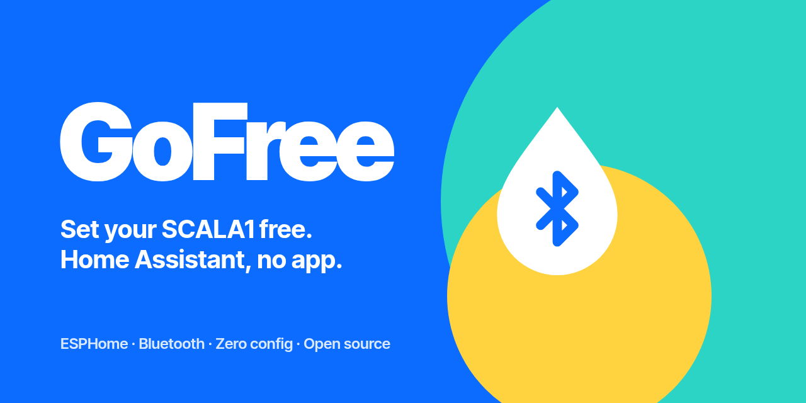

<p align="center">
  
</p>

<p align="center">
  <a href="https://esphome.io"></a>
  <a href="https://www.home-assistant.io"></a>
  <a href="LICENSE"></a>
</p>

**GoFree** puts your Grundfos **SCALA1** booster pump in Home Assistant over its built-in Bluetooth. An ESP32 next to the pump does the talking: no Grundfos GO app, no cloud, no wiring into the pump.

Flash the ESP32, press the blue button on the pump, done. GoFree finds the pump, pairs, and keeps the link up across reboots.

## What you get

| | |
|---|---|
| 💧 **Live status** | running, water demand, pressure detected, flow detected, priming |
| 🚨 **The pump's own alarms** | dry running (empty tank), too many starts per hour (small leak), leak detected, overheating… in plain English |
| 📈 **History** | starts (total, last hour, last 24 h), running time, last cycle |
| 🎛️ **Control** | stop the pump, set it back to automatic, reset alarms |
| ⚙️ **Settings, read-only** | dry-run protection and external input configuration |
| 🧩 **Blueprints** | stop the pump when the tank runs low · get notified on alarms |

Everything is local and pushed to Home Assistant within seconds.

## Why it exists

The SCALA1 only talks to the Grundfos GO app, one phone at a time. A standard Bluetooth pairing from Home Assistant or an ESP32 is always refused. GoFree reproduces how the official app actually pairs ([the details](docs/pairing.md)), then speaks the pump's GENIbus protocol ([the details](docs/protocol.md)).

## You need

- An ESP32 or ESP32-S3 board (any devkit, about €5), powered by USB, within a few metres of the pump.
- ESPHome 2026.10 or later, ESP-IDF framework.
- A SCALA1. Other Grundfos pumps with Bluetooth use the same pairing but other data: see [Other pumps](#other-pumps).

## Install

1. Create a new ESPHome device and paste [`examples/gofree-esp32.yaml`](examples/gofree-esp32.yaml), or add these lines to an existing ESP32 configuration:

   ```yaml
   external_components:
     - source: github://tatutsa888/gofree@v1.0.0
       components: [gofree]

   packages:
     gofree: github://tatutsa888/gofree/gofree.yaml@v1.0.0
   ```

2. Install it, and let Home Assistant adopt the device.
3. **Close the Grundfos GO app** on your phone: the pump accepts one connection at a time.
4. Wait for the pump's blue LED to **blink**, then **press the blue button for 3 seconds**. The LED stays on: you're paired.

Prefer French names? Use [`examples/gofree-esp32-fr.yaml`](examples/gofree-esp32-fr.yaml). Every entity name is a substitution, so any language works.

## Blueprints

| | |
|---|---|
| **Stop the pump when the tank runs low** | Stops the pump below a level you choose, restarts it when the tank has refilled, resets a dry-run alarm if needed, and never undoes a stop you made yourself. [Import](https://my.home-assistant.io/redirect/blueprint_import/?blueprint_url=https%3A%2F%2Fgithub.com%2Ftatutsa888%2Fgofree%2Fblob%2Fmain%2Fblueprints%2Fautomation%2Fgofree%2Flow_tank_cutoff.yaml) |
| **Tell me when the pump raises an alarm** | Runs your notification with the alarm in plain English. [Import](https://my.home-assistant.io/redirect/blueprint_import/?blueprint_url=https%3A%2F%2Fgithub.com%2Ftatutsa888%2Fgofree%2Fblob%2Fmain%2Fblueprints%2Fautomation%2Fgofree%2Fpump_alarm.yaml) |

## Entities

| Entity | Type | Notes |
|---|---|---|
| Running | binary sensor | the motor is turning |
| Water demand | binary sensor | pressure dropped: a tap, a toilet, a leak… Stays on while the pump is stopped |
| Pressure detected / Flow detected | binary sensor | from the pump's pressure switch and flow sensor (the SCALA1 does not measure them in bar or l/min) |
| In alarm | binary sensor | |
| Alarm / Warning | sensor | stable codes such as `DryRun`, `TooManyStartsPerHour`, handy in automations |
| Alarm description | sensor | the same in plain English |
| Starts, Starts last hour, Starts 24 h | sensor | |
| Total running time, Running time 24 h, Last cycle | sensor | |
| Pump enabled | switch | off = stopped even if pressure drops |
| Bluetooth link | switch | turn off to use the Grundfos GO app |
| Reset alarms, Forget pump | button | |
| Pump link, Pump found, Dry-run protection, External input, Status bytes… | diagnostic | |

## Troubleshooting

- **Nothing happens when I press the button.** Is the Grundfos GO app closed? Is the ESP32 close enough? Check the *Pump found* sensor: it shows the pump and its signal (−80 dBm or better is fine). Concrete floors block Bluetooth: put the ESP32 on the same side as the pump.
- **The LED keeps blinking.** GoFree is asking to pair: press the blue button.
- **It worked, then stopped.** Look at *Pump link*. If the pump was reset or the ESP32 replaced, press *Forget pump*, then the blue button.
- **Want the raw frames?** Set `logger: logs: gofree: DEBUG`.

## Other pumps

The transport, telegram format and pairing are shared by Grundfos Bluetooth products. The objects (what data lives where) are not. If you own another model, open an issue with a debug log: the *Bluetooth advertisement* sensor already shows its family and type.

## Credits

Built on the work of the community: [fitz247's SCALA1 ESPHome package](https://community.home-assistant.io/t/grundfos-scala1-pump-controller-esp-home/1031067), the [grundfos-bluetooth](https://github.com/tastyfrankfurt/grundfos-bluetooth) protocol notes and ESPHome's ALPHA3 component. Pairing, decoding and the rest were worked out on a real SCALA1, in a crawl space.

## Disclaimer

GoFree is an independent project, published for interoperability. It is not affiliated with, authorised or endorsed by Grundfos. Grundfos, SCALA and Grundfos GO are trademarks of Grundfos Holding A/S. Stopping a pump stops your water: test your automations, and use at your own risk.

MIT © 2026 tatutsa888
